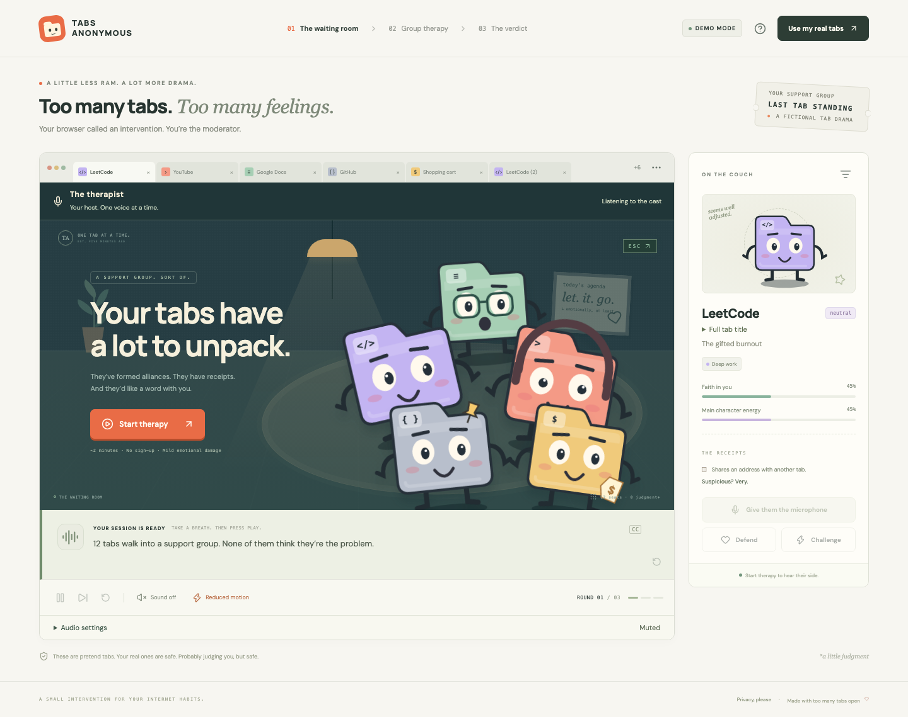
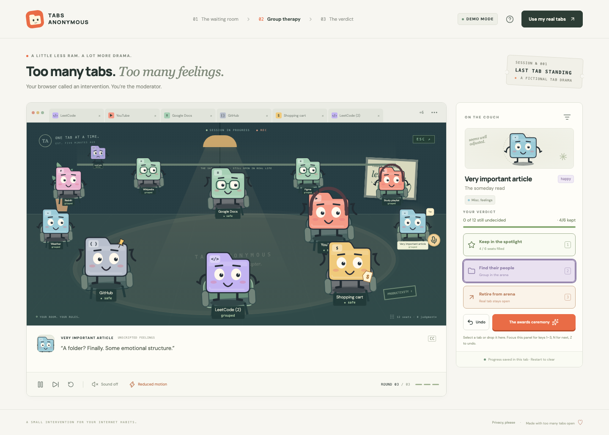
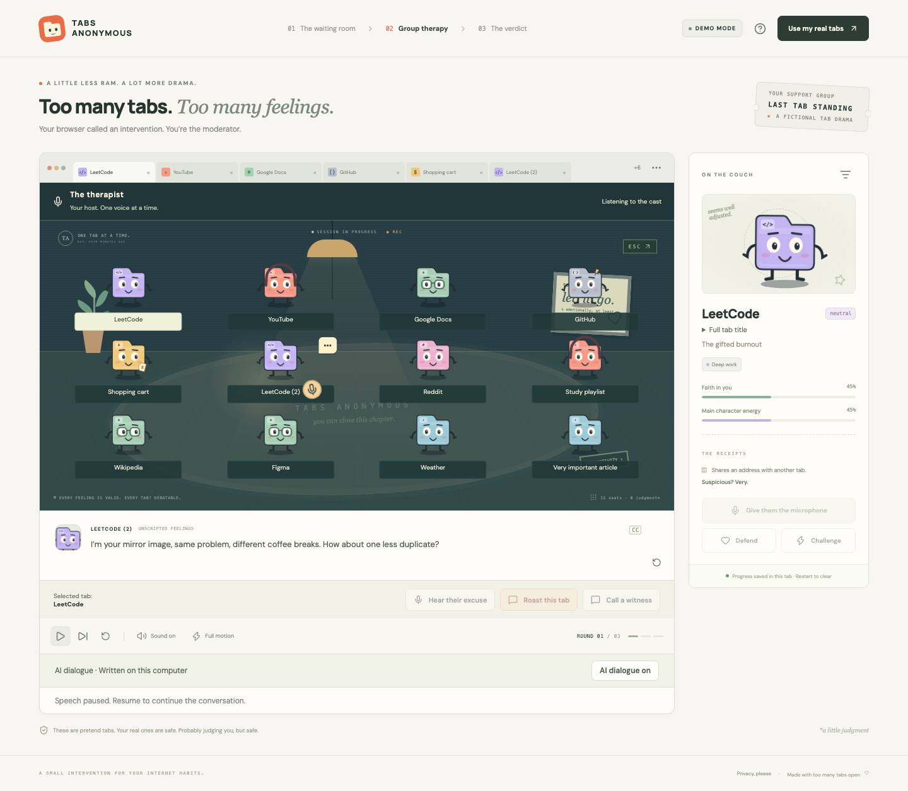

# Tabs Anonymous: Last Tab Standing

**Your browser tabs have formed a support group. They’d like a word with you.**

An animated, interactive tab therapy arena: twelve expressive characters confess, expose duplicates, form questionable alliances, and ask you to decide their fate. Release candidate v0.9.1 of the playable implementation of the [hackathon build spec](Tabs_Anonymous_Animated_Hackathon_Build_Spec.md).



For the current go/no-go assessment, Devpost copy, and the prepared private walkthrough, see [submission readiness](docs/submission-readiness.md).

## Run locally

Node 24 LTS recommended (minimum 22.12).

```sh
npm ci
npm run dev
```

Open **http://127.0.0.1:5173**. Kokoro voices run locally without an API key. Run `npm run voice:setup` once, then `npm run voice:server`. The captioned demo needs no server. Kokoro is the only speech engine. With [local AI setup](docs/ai.md), the cast writes fresh replies using tab topics and recent conversation. Start therapy enables AI; scripted captions continue if the writer is unavailable. Pause, skip, and interrupt at any time.

## What works

- Up to twelve original SVG tab characters with independent faces, eyes, mouths, arms, legs, accessories, and idle animation.
- A furnished therapy room, staggered entrances, speaking reactions, duplicate stamp, productivity alliance, popcorn gag, victory reactions, and arena retirements.
- Three story rounds; select a tab, give it the microphone, defend it, or challenge it. Trust, confidence, grudges, and alliances change deterministically.
- Keep up to six characters, group the others, or retire them from the fictional arena. Drag-and-drop and equivalent buttons; decisions remain reversible until the awards.
- Six action-dependent endings, 2400×1350 PNG award cards, a 15-second Full HD MP4/WebM recap without browsing details, and a detailed text recap.
- A desktop voting sidebar and mobile voting dock, verdict Undo, keyboard controls, and reload recovery.
- Contextual confessions and roasts use title topics, shared domains, duplicate addresses, and verdicts. **Call a witness** brings another tab to the microphone with testimony about the selected character.
- A readable balcony tray, uncluttered duplicate confrontations, expandable full titles, and outcome-based recaps with session highlights.
- Local AI conversations with callbacks to previous speakers, metadata-aware scripted fallback, eight character categories, and distinct automatic voices.
- Desktop/mobile layouts, captions, pause/skip/restart, persisted reduced-motion preference, and one Sound toggle with automatic Kokoro casting, local effects, and reaction delivery. No audio settings panel.
- Optional Chrome MV3 extension: permission prompt, local snapshot, 12 featured representatives, **Refresh cast and restart** for newly opened tabs, explicit native grouping preview, per-tab approval, stale-tab checks, and partial-failure reporting.
- Locally bundled fonts. No telemetry, page scraping, cloud speech, or external dialogue generation.



See the [animated recap](docs/screenshots/animated-recap.png), [mobile voting dock](docs/screenshots/voting-mobile.png), [native grouping preview](docs/screenshots/native-groups.png), and [shareable recap card](docs/screenshots/recap-card.png).

## Expressive voices

See [voice setup](docs/voices.md). Tap **Sound off** to connect to Kokoro. George always leads as the therapist; the 12 other voices are assigned automatically. Emotion delivery follows the character's reaction. Previous manual voice overrides are ignored. No settings, provider selection, auditions, or API keys.

Run `npm run voice:setup` once. On macOS, [local AI setup](docs/ai.md) installs the writer and registers both services to start at login. For speech alone, use `npm run voice:server`. The extension needs its ID in `.env`. Sound starts muted, with a compact readiness or retry message. **Replay line** repeats the current speech.



## Chrome extension

```sh
npm run build:extension
```

1. Open `chrome://extensions` in Chrome.
2. Enable **Developer mode**, choose **Load unpacked**, and select `dist-extension/`.
3. Click **Tabs Anonymous**, then **Open the therapy room**.
4. In the room, choose **Connect this window** to grant optional `tabs` and `tabGroups` permissions, or use the fictional demo.
5. Finish the session. Choose **Preview native groups**, review the exact tabs, and explicitly **Apply**.

The build also creates `artifacts/tabs-anonymous-extension.zip` when the `zip` utility is available. The unpacked directory works independently of ZIP creation.

**No tab-closing operation exists.** Pinned tabs, incognito tabs, non-HTTP(S) pages, and navigating tabs are excluded. Up to 12 eligible tabs become characters; the separate grouping preview can include all eligible tabs from the original current-window snapshot. Existing native groups may be changed only by an approved apply. Canceling the preview makes no changes.

This first version uses Vite to bundle a small native MV3 extension, sharing the exact same UI and simulation with the web demo. WXT, a side panel, and Chrome Web Store packaging are deferred. Session checkpoints are stored in the current tab’s sessionStorage and expire for restore after 24 hours. The extension rechecks permission and tab identity before restoring; its Forget session button clears saved progress and metadata.

## Commands

| Command                   | Purpose                                                   |
| ------------------------- | --------------------------------------------------------- |
| `npm run dev`             | Local demo with hot reload                                |
| `npm run build`           | Type-check and build static demo into `dist/`             |
| `npm run preview`         | Serve the production demo                                 |
| `npm run build:extension` | Build unpacked extension and optional ZIP                 |
| `npm run check`           | TypeScript plus core/director/grouping tests              |
| `npm run test:e2e`        | Build extension; desktop/mobile and native Chromium tests |
| `npm run format`          | Format source and project docs                            |

Install the test browser once with `npx playwright install chromium`. CI runs both builds and the tests. Generated bundles, node_modules, browser traces, and test screenshots stay out of Git; representative screenshots are tracked in `docs/screenshots/`.

## Architecture

```text
apps/web-demo          Vite entry point; no Chrome dependencies
apps/chrome-extension  MV3 launcher, consent, metadata snapshot, grouping adapter
packages/game-core     Pure TypeScript fixtures, facts, event deck, reducer, awards
packages/animation     One cancellable, pausable clock for the active beat
packages/ui            Shared React arena, SVG rigs, controls, results, styles
tests                  Unit tests and desktop/mobile Playwright flows
```

The reducer determines outcomes before visual effects. The animation director owns scene timing and commits each skip once. CSS handles expressive rigs, and Motion handles dragging. Chrome mutations live exclusively in the extension adapter; dialogue and game actions never have access to browser operations.

See [architecture](docs/architecture.md), [privacy](docs/privacy.md), [verification and remaining scope](docs/status.md), and [attribution](docs/attribution.md).

## Current limits

The demo is a complete playable local experience. Public hosting, a Chrome Web Store listing, manual native permission-dialog testing in Chrome/Brave, submission video capture, and remaining cinematic/stretch animations are still pending.

Native grouping now has an actual Chromium API test in a disposable profile with local fixture tabs. That test uses a copy of the manifest with pregranted permissions and a test-only worker; the shipped extension still requests optional permissions from the Connect button. Mocked adapter tests cover stale data and partial failures. Grouping is not transactional; the UI reports completed and failed groups explicitly.

Reload resumes a saved game in the same browser tab. A story resumes paused from the start of its current beat, while final decisions and Undo history survive. Real-mode restore requires unchanged eligible tabs in the original window. Restart clears game progress; Forget session clears real snapshot metadata too. Browser-managed closed-tab recovery may retain sessionStorage.

The awards screen includes a five-chapter animated reel with play/pause, chapter selection, scrubbing, and reduced motion. Save video creates a silent 1920×1080 film locally, requesting 30 fps and 12 Mbps. It uses H.264 MP4 when supported and WebM otherwise. Keep the tab visible during export; leaving or canceling stops the recorder. The video contains only fictional artwork, the award, and aggregate verdict counts. PNG cards remain available when video recording is unsupported. See [animated recap](docs/recap-video.md). Sound starts from a user click. Kokoro must be installed and the local service running; failures keep captions available with a Retry sound button. Pause cancels speech; resuming restarts the sentence. Physical speaker output still needs a check on the target device. A local Qwen3 model writes fresh dialogue from bounded tab metadata and recent conversation. Scripted lines are an explicit fallback. AI can misinterpret topics or produce weak jokes; it cannot read page bodies or control browser actions. The next scripted turn is written and voiced while the current speaker talks. Shorter replies and tighter speech pacing reduce dead air; the first line and unexpected interruptions can still need generation time. Refresh cast starts a new game from currently open eligible tabs and clears existing fictional verdicts. The entrance originates above the fictional strip rather than tracking each strip element with an exact shared-element transition.
