# TABS ANONYMOUS: LAST TAB STANDING
## Animation-first product requirements, technical architecture, motion bible, and hackathon build plan

> **Project type:** Interactive browser-tab comedy simulation + optional Chrome extension  
> **Tagline:** *Your browser tabs have formed a support group. Now they are voting on who gets deleted.*  
> **Document:** Research-grounded build specification, version 1.0  
> **Research date:** 18 October 2026  
> **Primary goal:** Make the **tab characters visually alive**, reacting to one another and to the player's decisions—not merely displaying LLM-generated dialogue.

---

## 0. Executive decision: what to build

**Build an animated, full-screen browser-tab therapy arena as the primary experience.** Each open tab becomes a small expressive character: the tab-shaped body has eyes, a mouth, arms, feet, a favicon badge, expressive poses, and a distinct voice *style* (text and optional sound). Tabs enter a circle of chairs, speak, interrupt, form alliances, jump between seats, throw reaction stickers, hold secret votes, plead for survival, and occasionally cause slapstick chaos. In the final scene the player can **approve** organizing the real Chrome tabs into groups; tabs are never silently closed.

**Ship two entry paths:**

1. **Instant Demo (must work):** a public website with 12 safe mock tabs and a curated 60–90 second dramatic sequence. No extension, API key, login, or permissions required. Critical for judges and sharing.
2. **Real Tabs Mode (valuable differentiator):** a Manifest V3 Chrome extension which, after explicit permission, reads eligible tabs in the current browser window and launches the same theater as an extension page. A user can preview and approve real tab-grouping operations.

**The defining wow moment:** A row of tiny tabs *visually jumps out of a fictional browser strip*, grows eyes and limbs, lands in therapy chairs with squash-and-stretch, and starts an escalating argument that changes the position, facial expression, allegiance, and fate of the other tabs. The actual native Chrome tab strip is not animated. This animation takes place in the app/extension page.

**Do not build:** a plain chatbot, a passive dialogue slideshow, an invasive extension that scrapes page bodies, or a simulation that auto-closes tabs.

---

## 1. Research conclusions and competing approaches

### 1.1 What exists already

| Existing work | Verified source | What it establishes | How our concept differs |
|---|---|---|---|
| Google Chrome Tabs API | [Official API](https://developer.chrome.com/docs/extensions/reference/api/tabs) | Query tabs, group them, move them, update them, and—with explicit action—close them. | We use real tab metadata to drive a character-based comedy simulation. |
| Chrome Tab Groups API | [Official API](https://developer.chrome.com/docs/extensions/reference/api/tabGroups) | Native groups can be titled, colored, and collapsed. | An approved ending can organize real tabs according to therapy outcomes. |
| Chrome Side Panel API | [Official API](https://developer.chrome.com/docs/extensions/reference/api/sidePanel) | MV3 extensions can show a persistent browser side panel. | The side panel is a launcher/summary; the big animations happen in a full extension page. |
| AI Tab Organizer | [elminson/tab-organizer](https://github.com/elminson/tab-organizer) | Real tab categorization and native tab grouping exist. | Utility alone is not novel. Our differentiator is animated character interactions and a playable story. |
| TabPet | [soph-lin/tabpet](https://github.com/soph-lin/tabpet) | A virtual pet and game-state behavior can live in an extension. | The entire *tab collection* becomes an ensemble cast with relationships and consequences. |
| Motion layout transitions | [Motion docs](https://motion.dev/docs/react-layout-animations) | React layout and shared-element transitions can be animated smoothly. | Perfect for tabs leaving a strip, sitting in seats, and being rearranged. |
| GSAP Flip | [GSAP Flip docs](https://gsap.com/docs/v3/Plugins/Flip/) | Coordinates complex transitions between DOM positions and sizes. | Optional for a signature “tab strip → therapy room” transformation. |
| Matter.js | [liabru/matter-js](https://github.com/liabru/matter-js) | 2D rigid-body physics, collision, and constraints. | Restrict physics to a contained comic chaos event, not ordinary UI layout. |

**Novelty assessment:** There are overlapping tab managers, animated browser pets, and AI-character simulators. An exact product matching this proposed game was *not established by the sources reviewed*; this is **not proof of global uniqueness**. The project's distinction must be the quality of emergent interaction and animation—not claiming no one has done it before.

### 1.2 Platform reality check

- **Possible:** read permitted tab titles/URLs, determine pinned and audible state, launch a side panel or an extension page, and organize eligible tabs through Chrome APIs.
- **Possible:** draw an imaginary browser strip and animate representations of tabs flying, talking, falling, running, fighting, crying, merging, and sitting on chairs.
- **Not supported as envisioned:** directly animate the browser's *native tab-strip chrome*—you cannot make real tabs grow legs and roam around the Chrome toolbar using normal extension APIs.
- **Do not misrepresent:** a browser tab title does not prove how long someone watched a video or what happened in that page. Historical time-on-tab requires tracking from the moment your extension starts observing activity; do not invent it.
- **Important:** Chrome's MV3 background service worker can be suspended. Persistent animation and game state belong in a visible document; save session checkpoints in extension storage.

Sources: [Tabs](https://developer.chrome.com/docs/extensions/reference/api/tabs), [Side panel](https://developer.chrome.com/docs/extensions/reference/api/sidePanel), [MV3 service worker lifecycle](https://developer.chrome.com/docs/extensions/develop/concepts/service-workers/lifecycle), [MV3 overview](https://developer.chrome.com/docs/extensions/develop/migrate/what-is-mv3).

---

## 2. Audience, user promise, and success criteria

**Primary audience:** students, developers, chronic tab-hoarders, and people who enjoy absurd interactive websites.

**One-sentence pitch:** *Turn your real browser tabs into an animated reality-show therapy session where they roast each other, form alliances, and compete for the right to survive—then organize your tabs if you choose.*

**Success at demo time:**

- Within **5 seconds**, a viewer understands that browser tabs are about to come alive.
- Within **15 seconds**, at least one tab displays a distinct expression and reacts to another tab.
- Within **30 seconds**, a surprising physical gag happens (a duplicate bursts in, YouTube flees, a tab flips a chair, etc.).
- Within **60–90 seconds**, the viewer has chosen a fate for a tab and seen consequences.
- Judges can complete the whole demo without permissions, extension setup, or API credentials.
- Real Tabs Mode can successfully classify and group consenting users' tabs without deleting them.

These are **design targets**, not empirically verified results.

---

## 3. The user journey: 90-second signature demo

**Scene 0 — Boot (0–5 s).** Fake Chrome top bar displays 12 familiar-looking *parody* tabs. The loading indicator says: `39 tabs detected. 0 emotional stability detected.` Small tooltip: **Start therapy**.

**Scene 1 — Escape (5–12 s).** User clicks Start. Tab-shaped cards detach from the fictional strip one by one, stretch as if made of rubber, sprout stick legs, and jump into a circular meeting room. YouTube trips on its own play button. A Google Docs tab politely straightens the chairs.

**Scene 2 — Introductions (12–28 s).** Spotlight follows a LeetCode character. Its brows lower and mouth lip-syncs (simple mouth-state animation) to a typed caption: “I haven't been solved. I've been emotionally bookmarked.” Two YouTube characters snicker and share a look. The third duplicate LeetCode arrives late and pretends not to know the others.

**Scene 3 — Evidence (28–43 s).** A giant **DUPLICATE ALERT** stamp slams onto the stage. Two near-identical tabs examine each other, then act out the Spider-Man pointing meme *without copying licensed artwork*. A tiny speech bubble says: “One of us is redundant. Statistically, it's him.” A randomized but **bounded** scripted argument follows.

**Scene 4 — Debate and betrayal (43–62 s).** User selects **Give GitHub the microphone**. GitHub receives a mic and denounces YouTube. YouTube tosses a popcorn projectile, which knocks over the `Productivity` sign. Tabs on the same team scoot closer; enemies turn away.

**Scene 5 — Survival vote (62–78 s).** Only **6** can stay in the arena. Tabs display their loyalty and usefulness badges. The player drags a tab toward **Keep**, **Group**, or **Retire from Arena**. One rejected tab grabs the edge, kicks its legs, and screams “I WAS A VERY IMPORTANT ARTICLE!” The result updates character relationships.

**Scene 6 — Result (78–90 s).** The room becomes a mock awards show: `Professional Procrastinator`, `Most Delusional Productivity Tab`, and `Ctrl+Z in Human Form`. A shareable **fictionalized** recap card appears. In Real Tabs Mode: **Preview native tab groups** → **Apply** (explicit confirmation). In demo mode: fake groups are displayed, no real tabs touched.

**Comedy rule:** Every spoken joke should produce a visible change—an expression, movement, prop interaction, alliance marker, stage lighting, or physical consequence. Avoid standing portraits with text bubbles.

---

## 4. Visual identity and art direction

### 4.1 Art style

**Direction:** cute animated sticker characters + late-night therapy/reality-show set + slightly chaotic desktop UI.

- **Characters:** small rounded-browser-tab silhouettes (not the actual Chrome tab UI), big expressive eyes, tiny mouths, short noodle arms, flexible legs, favicon-like badges.
- **Stage:** a 2.5D therapy room, armchairs/cushions in an ellipse, a spotlight, whiteboard, paper ballot box, vending machine marked `RAM`, emergency exit marked `Close All`.
- **UI aesthetic:** crisp typography, dark navy/indigo background, warm pastel character accents, animated shadows, clean dialogue subtitles.
- **Two moods:** cozy therapy mode (warm lighting, slower easing) and elimination mode (dramatic spotlight, camera zoom, comic dust clouds).
- **Character differentiation:** each category gets a silhouette accessory and movement language, not only color.

Example character language:

| Archetype | Look | Idle personality | Big gag animation |
|---|---|---|---|
| Video / entertainment | Popcorn bucket, headphones | Rhythmic bouncing and side-eye | Slides out of chair; throws popcorn; ducks consequences |
| Coding challenge | Eyebrows, tiny sweatband | Restless tapping and judging | Launches whiteboard equation at another tab |
| Code repository | Hoodie, terminal sticker | Stoic blink and crossed arms | Opens giant issue list as a shield |
| Shopping cart | Price-tag scarf | Sneaky eye dart | Pulls a fake **LAST CHANCE** sale banner |
| Study document | Glasses, clipboard | Upright, anxious | Quietly raises hand while chaos happens |
| Social feed | Notification bell | Hyperactive jitter | Multiplies emoji reaction confetti |
| Unknown / other | Neutral detective hat | Curious bounce | Reveals unexpected personality after user interacts |

Avoid using brand mascots, logos as characters, copyrighted meme artwork, or visual elements in a way suggesting endorsement. Actual permitted favicons can be badges when technically and legally appropriate, but generic symbols are sufficient and safer for public demos.

### 4.2 Layout at desktop size (1440×900 design reference)

```text
┌────────────────────────────────────────────────────────────────────────────┐
│ TABS ANONYMOUS   │ Therapy / Arena / Results │ 12 tabs  │ Volume │ Menu │
├────────────────────────────────────────────────────────────────────────────┤
│ Fictional browser strip: [LeetCode] [YT] [Docs] [GitHub] ...               │
├───────────────────────────────────────────────────┬────────────────────────┤
│                                                   │ CHARACTER DOSSIER      │
│       STAGE / THERAPY CIRCLE                      │ Name + expression      │
│                                                   │ Grudge / alliance meter│
│      [YT]         [GitHub]        [Docs]           │ Evidence cards         │
│                                                   │                        │
│           [Therapist]                              │ PLAYER ACTIONS         │
│      [Shopping]    [LeetCode]                      │ Defend / Challenge     │
│                                                   │ Keep / Group / Retire  │
├───────────────────────────────────────────────────┴────────────────────────┤
│ LIVE CAPTIONS — "I've been open since you said 'I'll study in 5 minutes'" │
│ [Skip]   [Pause]   [Replay]   [Reduce motion]             Round 1 / 3       │
└────────────────────────────────────────────────────────────────────────────┘
```

**Mobile/tablet:** responsive demo UI with stage above a swipeable character drawer. Actual Chrome extension is desktop-first.

---

## 5. ANIMATION BIBLE — the project's highest-priority section

Animations should be **state-driven** and tell jokes. Below are concrete animation specifications, not a wishlist.

### 5.1 Motion system

| Motion tier | Purpose | Typical duration | Easing / method |
|---|---|---|---|
| Micro | Blink, eye shift, eyebrow, button hover | 80–250 ms | Ease-out; procedural CSS/SVG |
| Character reaction | Nod, gasp, side-eye, facepalm | 220–550 ms | Spring / overshoot |
| Stage movement | Jump, walk, chair swap | 450–900 ms | Spring + path / FLIP |
| Cinematic beat | Spotlight, smash zoom, betrayal reveal | 500–1200 ms | Coordinated GSAP timeline |
| Ambient | Breathing, leg swings, floating steam | 1.5–4 s, throttled | Low-amplitude loop |
| Chaos | Physics burst, popcorn, chairs wobbling | 1–3 s | Matter.js or particles |

**Animation budget:** 1 primary dramatic event at once, up to 2 secondary reactions, and no more than 12 fully animated tab characters in the foreground. Excess tabs become simpler crowd silhouettes or representative category groups.

### 5.2 Character rig and expression states

Each tab character is an SVG/HTML composition:

```text
TabCharacter
├── rounded tab body
├── badge (category icon or sanitized favicon)
├── eyes (pupils independently track speaker)
├── eyebrows (rotate up/down)
├── mouth (closed / open / smile / gasp / angry)
├── left & right arm (pivot at shoulder)
├── left & right leg (pivot at hip)
├── shadow (scales with jump height)
├── accessory (category specific)
├── emotion emote bubble
└── spoken-caption anchor
```

**Expression states:** `neutral`, `happy`, `smug`, `confused`, `embarrassed`, `angry`, `shocked`, `sleepy`, `crying`, `victorious`, `panicking`, `suspicious`. Expression is derived from mood + event (not randomly changed every frame). At minimum implement 6 for the hackathon.

**Locomotion:** `idle`, `walk`, `run`, `hop`, `jump`, `slide`, `fall`, `dragged`, `exit`. Switch animation based on actual state. Arms and legs swing with movement. The shadow compresses/expands as the character changes height; the tab body squashes upon landing.

**Speech:** switch mouth frames at a limited rhythm while text appears; avoid pretending to have accurate phoneme sync without audio analysis. Speech must be readable even with sound muted.

### 5.3 Animation event catalogue (40 beats)

| ID | Animation | Trigger | Visual choreography | MVP? |
|---|---|---|---|---|
| A01 | **Tab-strip breakout** | Session begins | Mini-tab translates into stage, scales up, sprouts legs | **YES** |
| A02 | **Staggered entrance** | Cast joins | Each character arrives 100–180 ms after previous | **YES** |
| A03 | **Chair landing** | Character reaches seat | Squash, spring-back, tiny dust puff | **YES** |
| A04 | **Idle breathing** | No event | Body subtly rises and falls | **YES** |
| A05 | **Blink + eye follow** | Idle / speaker changes | Pupils aim toward active speaker | **YES** |
| A06 | **Talking mouth** | Dialogue plays | Mouth toggles, character bobs | **YES** |
| A07 | **Side-eye chain** | One tab embarrasses another | 2–3 tabs glance at culprit in sequence | **YES** |
| A08 | **Disapproval head shake** | Bad argument | Pivot 3° left/right twice | **YES** |
| A09 | **Collective gasp** | Twist or reveal | Group bounce, open-mouth expression | **YES** |
| A10 | **Spotlight entrance** | Speaker selected | Stage dims and spotlight follows speaker | **YES** |
| A11 | **Microphone toss** | New speaker | Mic object arcs toward receiver | Later |
| A12 | **Reaction bubble pop** | Funny line | Emoji/symbol expands then settles | **YES** |
| A13 | **Duplicate standoff** | Similar URLs/titles | Two characters mirror and point at each other | **YES** |
| A14 | **Stamp slam** | Duplicate revealed | BIG `DUPLICATE` rubber stamp slams down | **YES** |
| A15 | **Suspicious sniff** | Contradictory defense | Detective character sniffs around target | Later |
| A16 | **Rage vibration** | Anger exceeds threshold | 2–3 small shakes, red cheeks | **YES** |
| A17 | **Quiet rage** | Anger high | Eyes narrow; stillness before reaction | Later |
| A18 | **Chair swap** | Alliance increases | Two characters relocate using layout animation | **YES** |
| A19 | **Friendship fist bump** | Alliance formed | Arms meet; spark effect | Later |
| A20 | **Betrayal backstep** | Loyalty breaks | Character recoils, badge cracks | **YES** |
| A21 | **Fake crying** | Rejected at vote | Tears, exaggerated shoulders, napkin | **YES** |
| A22 | **Desperate cling** | Dropped in retire zone | Legs dangle; arms cling to ledge | **YES** |
| A23 | **Tiny victory dance** | Tab protected | Two hops + confetti burst | **YES** |
| A24 | **Dramatic courtroom objection** | Challenge action | Desk slam, speech-card snap, spotlight | Later |
| A25 | **Popcorn projectile** | Entertainment character mocks | Safe projectile knocks over cardboard prop | Later |
| A26 | **Reaction wave** | Multiple tabs agree | Wave of tilted tab bodies around circle | **YES** |
| A27 | **Argument split screen** | Two characters debate | Camera frames both; alternating head turns | Later |
| A28 | **Alliance huddle** | Coalition forms | Characters move into a mini-circle, whisper icons | Later |
| A29 | **Secret ballot** | Voting starts | Tabs write miniature ballots and drop them | **YES** |
| A30 | **Ballot-box suspense** | Vote reveal | Box rattles, pause, suspenseful zoom | **YES** |
| A31 | **Elimination trapdoor** | Arena retirement | Character falls into padded cartoon portal | **YES** |
| A32 | **Rescue rope** | User reverses arena choice | Surviving character helps another back | Later |
| A33 | **Shopping-sale banner** | Shopping tab pleads | Giant sale ribbon unfurls and tangles | Later |
| A34 | **Notification explosion** | Social category becomes stressed | Controlled burst of icon stickers | Later |
| A35 | **Code issue shield** | GitHub-type character challenged | A fake issue list unfolds as shield | Later |
| A36 | **Fire drill** | Chaos reaches threshold | Everyone scatters briefly, then returns | Later |
| A37 | **Award podium morph** | Game ending | Therapy chairs rearrange into podium positions | **YES** |
| A38 | **Category badge ceremony** | Awards announced | Badge slides onto winning character | **YES** |
| A39 | **Group portal** | Real grouping preview | Characters fly into color-coded fake folders | **YES** |
| A40 | **Curtain call** | Session completed | Whole cast bows; credits roll | Later |

**MVP order:** A01 → A03 → A05/A06 → A10 → A13/A14 → A18/A20 → A29/A30 → A31 → A37/A39. These alone create a compelling beginning, middle, and end.

### 5.4 Choreography examples with exact intent

**Sequence S1: Intro / 6 seconds**

| Time | Event |
|---|---|
| 0.00 s | Music sting after Start click; stage lights warm up. |
| 0.30 s | Fictional tab strip shakes lightly. |
| 0.60 s | First tab lifts, rotates 5°, and jumps onto stage. |
| 1.00 s | Second tab stretches and lands with squash. |
| 1.20–3.40 s | Remaining foreground tabs arrive in staggered waves. |
| 3.70 s | Characters look left/right and blink. |
| 4.40 s | Therapist's bubble appears: “Welcome to Tabs Anonymous.” |
| 5.50 s | LeetCode facepalms and chair creaks. |

**Sequence S2: Duplicate confrontation / 4 seconds**

| Time | Event |
|---|---|
| 0.00 s | Both duplicate tabs slide toward center. |
| 0.35 s | Mirrored head tilt and synchronized eye tracking. |
| 0.80 s | Rubber stamp slams `SAME URL, DIFFERENT DENIAL`. |
| 1.30 s | Both point accusingly at each other. |
| 1.70 s | Crowd performs a delayed gasp wave. |
| 2.30 s | Fake dramatic zoom on confused faces. |
| 3.00 s | The loser retreats into their chair, sulking. |

**Sequence S3: Elimination / 5 seconds**

| Time | Event |
|---|---|
| 0.00 s | Player drags tab above `Retire from Arena`. |
| 0.20 s | Target highlights and tab starts frightened leg kick. |
| 0.45 s | On drop, freeze-frame for 250 ms with dramatic caption. |
| 0.80 s | Trapdoor opens; character tries to cling. |
| 1.60 s | Character drops into clearly *fictional* portal. |
| 2.30 s | Other tabs react based on relationships: cheer, gasp, or cry. |
| 3.00 s | Retired character appears in safe `Archived` balcony, unharmed. |
| 4.20 s | Next round button becomes available. |

**Rule:** Avoid extended blocking animation. Every sequence has a Skip affordance; key story state is committed before/after the effect in a reversible, testable manner.

### 5.5 Character behavior machine

```text
SPAWN -> ENTER -> IDLE
                  ├─ LISTEN -> REACT -> IDLE
                  ├─ SPEAK -> REACT_TO_INTERRUPTION -> SPEAK/IDLE
                  ├─ RELOCATE -> SIT -> IDLE
                  ├─ DRAGGED -> DROP_KEEP / DROP_GROUP / DROP_RETIRE
                  ├─ PANIC -> RECOVER -> IDLE
                  └─ ELIMINATED_FROM_ARENA -> ARCHIVED_BALCONY
```

Events must set a **logical** status and dispatch an **animation cue**. Never infer game outcomes from whether a CSS animation happened to complete.

**Example reaction rules:**

```text
if speaker insults target AND target.anger > 65:
    cue(target, "rage_vibration")
if allies[speaker,target] > 60:
    cue(target, "supportive_nod")
if two tabs share a normalized URL:
    queue("duplicate_standoff") exactly once per pair per round
if rejected tab is ally of another:
    queue("sad_ally_reaction") after elimination sequence
```

### 5.6 Interaction animations

- **Hover:** eyes track cursor inside the character card; 1–2° tilt; tooltip displays actual metadata facts without inventing browsing history.
- **Click:** character springs forward to the microphone, spotlight transitions, dossier slides open.
- **Drag:** character lifts 10–20 px, shadow expands, legs dangle; valid drop zones glow.
- **Drop on Keep:** joyful bounce, halo and supportive crowd reaction.
- **Drop on Group:** slides through a glowing folder portal; team members cheer.
- **Drop on Retire:** cling-and-slide gag; the real browser tab remains untouched unless user later approves an explicit operation.
- **Pause:** stop animation timelines and typewriter timers; captions remain accessible.
- **Reduce motion:** use fades and instant rearrangements, no camera zooms or physics gag.

### 5.7 Audio design

Audio **off by default** or clearly opt-in. Suggested clips: chair squeak, mic pop, stamp thunk, suspense drum, ballot shake, tiny victory fanfare, portal poof. Use short, original/royalty-cleared effects and low volume; never blast audio on page load. [Howler.js](https://github.com/goldfire/howler.js) handles sound sprites and per-effect volume. Every important event must also be visible or captioned.

### 5.8 Performance strategy

- Favor `transform` and `opacity`, not frequent changes to `top`, `left`, or layout.
- Keep logical state in React; drive large effects via a single animation director, **not** a React state update on every animation frame.
- Use SVG/CSS for character rigs, Motion for layout/drag, GSAP for signature coordinated scenes. Add Matter.js *only* if the core loop is already complete.
- Cap foreground characters at **12**. Represent the remaining tabs as a stationary audience or summarized cohorts.
- Cache categorized metadata, debounce tab events, avoid rendering updates while the extension page is backgrounded.
- Use the system [`prefers-reduced-motion`](https://developer.mozilla.org/en-US/docs/Web/CSS/Reference/At-rules/%40media/prefers-reduced-motion) preference and a manual reduced-motion toggle.
- Target smooth animation on a normal laptop; measure dropped frames rather than promising 60 fps everywhere.

---

## 6. The game: mechanics that make this more than talking avatars

### 6.1 Three rounds

**Round 1: Confession.** Each representative tab reveals a fact-based reason it exists. The player can ask questions and choose who speaks next. Detect duplicates and cross-category contradictions.

**Round 2: Alliances and accusations.** Characters have evolving preferences. A tab can back another, defect, issue a challenge, or expose duplicate behavior. Some accusations are scripted from safe metadata; randomness chooses *which valid event* fires, not whether facts are invented.

**Round 3: Last Tab Standing.** The player chooses the arena's survivors and their categories. A final awards ceremony visualizes the decisions, then optional real-world grouping becomes available.

### 6.2 Tab facts versus comic fiction

| Fact safe to derive with permission | Allowed joke | Not allowed without tracking/consent |
|---|---|---|
| Three tabs share the same normalized URL | “You're triplets with the same homework.” | Claim they were abandoned for three weeks. |
| An eligible tab is pinned | “I'm pinned. I'm literally management.” | Claim user never closes pinned tabs. |
| Tab currently has audible status | “I am loudly contributing to the meeting.” | Claim what music or content it plays. |
| Several tab domains are in study category | “We founded an unpaid homework committee.” | Claim a specific exam was failed. |
| Current-window tab count | “This room has occupancy issues.” | Infer psychological traits or medical conditions. |

**Comedy must be safe by construction:** use observable facts, user choices, and fictional exaggerations rather than fabricated personal histories.

### 6.3 Relationship and emotion model

Each character has:

- `mood`: -100..100
- `anger`: 0..100
- `confidence`: 0..100
- `loyaltyToUser`: -100..100
- `allies`: weighted edges with other character IDs
- `grudges`: weighted edges
- `utilityEstimate`: deterministic heuristic used only inside the game (not presented as objective truth)
- `protectFromRealActions`: true for pinned/system/sensitive tabs and user-protected tabs

Example scoring **for entertainment only**:

```text
survivalAppeal =
  0.35 * utilityEstimate
+ 0.25 * confidence
+ 0.20 * numberOfAlliesNormalized
+ 0.20 * playerSupport
+ smallSeededTieBreak
```

**Important:** The final vote is a *game outcome*, not a recommendation algorithm that secretly closes tabs. User retains full authority over Chrome actions.

### 6.4 Event engine and interesting trade-offs

Use an event deck with preconditions and consequences. Events are executed through a reducer:

```text
EVENT: duplicate_exposed
PRE: two eligible tabs have same normalized URL
EFFECTS: trust(a,b) -= 15; anger(b) += 10; groupSuggestion = duplicates
ANIMATIONS: duplicate_standoff -> stamp_slam -> crowd_gasp
DIALOGUE: choose one of several authored jokes or optional AI rewrite

EVENT: defend_tab
PRE: player selected target
EFFECTS: loyalty(target,user) += 15; allies(target,defender) += 8
ANIMATIONS: protective_step -> tiny_victory_dance
DIALOGUE: appreciative but sarcastic line
```

**Seed each run** so debug/test sessions can be replayed. An event requires (a) valid facts, (b) a clear state change, (c) a visual outcome, and ideally (d) a joke. If an event has no state change, it is background flavor, not a core interaction.

### 6.5 Game outcomes

- **The Responsible Adult:** balanced study/work/entertainment groups.
- **Professional Procrastinator:** mostly entertainment survives; confetti is inappropriate but plentiful.
- **The Hoarder:** user saves everything; therapy room expands into a stadium.
- **The Betrayer:** user eliminates former allies; podium refuses to clap.
- **Chaos Manager:** duplicate tabs form a new coalition and take over voting.

Each ending should be achievable from deterministic player actions, not rely on hallucinated outcomes.

---

## 7. Technical architecture

### 7.1 Recommended stack

| Layer | Choice | Why |
|---|---|---|
| Framework | React + TypeScript + Vite | Fast prototyping, component-friendly |
| Extension build | [WXT](https://github.com/wxt-dev/wxt) with React | Manifest V3, side-panel entrypoints, dev reload |
| Styling | Tailwind CSS + custom CSS vars | Speed plus precise motion styling |
| Component animation | [Motion for React](https://motion.dev/docs/react) | Springs, draggable characters, layout transitions |
| Cinematic effects | [GSAP](https://github.com/greensock/GSAP) | Animation timelines and sequenced beats |
| State | Zustand or React reducer | Simple, transparent session store |
| Game logic | Pure TypeScript event reducer | Reproducible, testable, independent of rendering |
| Physics | [Matter.js](https://github.com/liabru/matter-js), optional | Only for 1–2 signature gag sequences |
| Audio | [Howler.js](https://github.com/goldfire/howler.js), optional | Short effect playback and mute controls |
| Local persistence | `chrome.storage.local` in extension; local state in demo | Avoid obligatory back end |
| Tests | Vitest + Playwright | Unit state tests + browser demo E2E |

**Pragmatic decision:** Start with Motion and SVG. Bring in GSAP for the big entry and exit scenes once simple animation works. Do **not** adopt PixiJS, Rive, WebGL shaders, Matter.js, and GSAP simultaneously: the asset/tooling overhead may kill the hackathon schedule. [PixiJS](https://github.com/pixijs/pixijs) and [Rive React](https://github.com/rive-app/rive-react) are researched upgrades for a later release.

### 7.2 Architecture diagram

```mermaid
flowchart TD
  Visitor[Judge / user] --> Demo[Public Demo Mode]
  Visitor --> Extension[Chrome Extension Mode]
  Extension --> Consent[Permission + preview]
  Consent --> TabsAPI[chrome.tabs + tabGroups API]
  TabsAPI --> Normalize[Sanitize and categorize snapshot]
  Demo --> Fixtures[Safe sample tab data]
  Fixtures --> Core[Shared simulation core]
  Normalize --> Core
  Core --> Reducer[Game state reducer + relationship graph]
  Core --> Director[Animation director / event queue]
  Reducer --> Director
  Director --> Stage[React SVG character stage]
  Reducer --> Proposal[Proposed tab groups]
  Proposal --> Preview[Review exact changes]
  Preview -->|Explicit Apply| TabsAPI
  Stage --> Recap[Shareable fictionalized recap]
```



**Separation is non-negotiable:** `game-core` must import **no** `chrome.*` APIs. This allows the demo and extension to share mechanics, permits headless tests, and prevents accidental browser mutations from character dialogue.

### 7.3 Suggested repository layout

```text
tabs-anonymous/
├── apps/
│   ├── web-demo/                 # Vite React hosted demo
│   └── chrome-extension/         # WXT MV3 extension
│       ├── entrypoints/
│       │   ├── background.ts     # lightweight event / message bridge
│       │   ├── sidepanel/        # quick launcher + consent status
│       │   │   └── index.html
│       │   └── arena/            # full theater extension page
│       │       └── index.html
│       └── wxt.config.ts
├── packages/
│   ├── game-core/
│   │   ├── types.ts
│   │   ├── reducer.ts
│   │   ├── events.ts
│   │   ├── classify.ts
│   │   ├── relationships.ts
│   │   └── fixtures.ts
│   ├── animation/
│   │   ├── director.ts
│   │   ├── sequences.ts
│   │   └── motion-presets.ts
│   └── ui/
│       ├── TabCharacter.tsx
│       ├── TherapyArena.tsx
│       ├── StageEffects.tsx
│       ├── Captions.tsx
│       ├── VoteZones.tsx
│       ├── Dossier.tsx
│       └── ResultScreen.tsx
├── tests/
├── docs/
│   ├── storyboard.md
│   ├── character-sprites.md
│   ├── privacy.md
│   └── devpost-submission.md
├── README.md
└── package.json
```

WXT recognizes side-panel HTML entrypoints in `entrypoints/sidepanel/index.html`; verify output names and configure extension page routing according to [WXT entrypoints docs](https://wxt.dev/guide/essentials/entrypoints.html). The exact monorepo package commands can be customized after bootstrapping; do not blindly treat this sketch as a fully initialized repository.

### 7.4 Typed game entities

```ts
type Category =
  | 'study' | 'code' | 'video' | 'social' | 'shopping' | 'work' | 'other';

type Mood =
  | 'neutral' | 'happy' | 'smug' | 'angry' | 'sad' | 'shocked' | 'panic';

type StageStatus =
  | 'entering' | 'seated' | 'speaking' | 'reacting'
  | 'moving' | 'retired' | 'awarded';

type TabCharacter = {
  id: string;                         // session-local character ID
  chromeTabId?: number;               // only extension mode, never share
  windowId?: number;
  label: string;                      // sanitized, bounded display string
  domainLabel?: string;               // optional simplified host
  category: Category;
  pinned: boolean;
  audible: boolean;
  duplicateGroup?: string;
  mood: Mood;
  anger: number;
  confidence: number;
  loyaltyToUser: number;
  status: StageStatus;
  protected: boolean;
  vote: 'keep' | 'group' | 'retire' | null;
};

type Relationship = {
  fromId: string;
  toId: string;
  affinity: number;                   // -100 to +100
};

type AnimationCue = {
  id: string;
  type: string;
  actorIds: string[];
  priority: 'primary' | 'reaction' | 'ambient';
  payload?: Record<string, unknown>;
};

type GameSession = {
  mode: 'demo' | 'extension';
  round: 1 | 2 | 3;
  seed: number;
  characters: TabCharacter[];
  relationships: Relationship[];
  eventLog: Array<{ type: string; actorIds: string[]; atStep: number }>;
  queuedCues: AnimationCue[];
  paused: boolean;
};
```

**Persistence caution:** Chrome tab IDs can change across sessions. Treat snapshots as ephemeral; rescan and validate tabs before grouping them. Never use `chromeTabId` as a stable archival identifier.

---

## 8. Extension implementation and privacy

### 8.1 Permissions

Recommend a **minimal base** extension with `sidePanel` and `storage`. Request optional `tabs` permission after the user presses **Use My Tabs**, and `tabGroups` only when the user opts into group organization. Chrome supports runtime optional permission requests; prompt wording must explain the power being granted.

Example *illustrative* MV3 manifest fields (WXT usually generates the final manifest):

```json
{
  "manifest_version": 3,
  "name": "Tabs Anonymous",
  "version": "0.1.0",
  "permissions": ["storage", "sidePanel"],
  "optional_permissions": ["tabs", "tabGroups"],
  "action": { "default_title": "Open Tabs Anonymous" },
  "side_panel": { "default_path": "sidepanel.html" }
}
```

Read: [Permission declarations](https://developer.chrome.com/docs/extensions/develop/concepts/declare-permissions) and [runtime optional permissions](https://developer.chrome.com/docs/extensions/reference/api/permissions).

### 8.2 Safe snapshot (illustrative TypeScript)

```ts
async function getCurrentWindowSnapshot() {
  const granted = await chrome.permissions.contains({ permissions: ['tabs'] });
  if (!granted) throw new Error('Tab access has not been approved.');

  const tabs = await chrome.tabs.query({ currentWindow: true });

  return tabs
    .filter(tab => typeof tab.id === 'number')
    .filter(tab => !tab.incognito)
    .filter(tab => tab.url?.startsWith('https://') || tab.url?.startsWith('http://'))
    .map(tab => {
      const parsed = new URL(tab.url!);
      return {
        id: tab.id!,
        windowId: tab.windowId,
        title: (tab.title ?? 'Unnamed tab').slice(0, 90),
        // Strip URL path, query, fragment, credentials, and tokens.
        hostname: parsed.hostname.toLowerCase(),
        pinned: Boolean(tab.pinned),
        audible: Boolean(tab.audible)
      };
    });
}
```

**Note:** `chrome.tabs.query()` behavior and exposure of sensitive fields depend on effective permissions; the code assumes `tabs` permission was granted. The helper intentionally excludes non-HTTP tabs and incognito tabs, and uses hostname rather than whole URLs for categorization. **Optional:** only store a locally computed opaque duplicate key when you need exact duplicate detection; never serialize URLs into transcripts. Full-path duplicate detection should run locally and only when justified.

### 8.3 Tab organization flow

1. Capture current-window eligible tab IDs.
2. Build and render proposed native groups: `Study`, `Work`, `Entertainment`, `Shopping`, `Misc`.
3. Show every tab's proposed destination, and allow user to uncheck tabs.
4. Exclude pinned tabs, incognito/private contexts, internal pages, and protected tabs from mutations.
5. On explicit **Apply Groups**, **rescan** and validate IDs, window association, eligibility, and current state.
6. Call `chrome.tabs.group({ tabIds: ... })` for selected tabs in compatible groups and `chrome.tabGroups.update()` to set title/color.
7. Report partial failures truthfully; don't show a success toast until Chrome returns success.
8. Do **not** auto-close tabs. Arena `Retire` only removes a character from the game. A separate future `Close Selected Tabs` feature would require an additional explicit confirmation and carefully scoped selection.

**Cross-window note:** Chrome tab groups belong to windows; apply groups per window, never assume you can put tabs from different windows into one existing group. Pinned tabs should stay outside the grouping flow. Grouping may change tab order; warn about that in the preview.

```ts
async function applyOneNativeGroup(tabIds: number[], title: string) {
  if (!tabIds.length) return;
  const allowed = await chrome.permissions.contains({ permissions: ['tabGroups', 'tabs'] });
  if (!allowed) throw new Error('Tab grouping access not granted.');

  // The caller must already have revalidated that all IDs are eligible,
  // unpinned, in the same normal window, and explicitly approved.
  const groupId = await chrome.tabs.group({ tabIds });
  await chrome.tabGroups.update(groupId, { title, color: 'blue' });
}
```

### 8.4 Privacy and security rules

- **Default demo mode has zero browser data access.**
- Request access **only** after a clearly worded user action; explain why.
- Keep tab titles/hosts and relationships locally by default. No telemetry by default.
- No page body scraping, cookies, keystroke collection, browsing-history permission, password manager data, or arbitrary host permissions for MVP.
- No sending exact URLs, auth-token-bearing URL queries, private tab titles, or sensitive category labels to an LLM by default.
- A future AI mode must require opt-in, show the exact redacted payload preview, and clearly disclose the model/provider.
- A tab title is **untrusted text**. Render as text; never inject into HTML, code, system prompts, or instructions.
- AI output, if enabled, may contribute safe joke text but **cannot issue Chrome API calls** or decide which tabs to close.
- MV3 packaged extension JavaScript must be bundled; no remotely hosted executable code. API requests for data are different from loading executable remote JS.
- Avoid exposing browsing data in share cards; share aggregated fictional awards, not personal hosts or titles.
- Provide **Erase Session** and ephemeral mode; delete stored snapshots on request.
- Extension storage is not an encrypted vault. Avoid storing private browsing details there long-term.

Sources: [MV3 security](https://developer.chrome.com/docs/extensions/develop/migrate/what-is-mv3), [Permissions](https://developer.chrome.com/docs/extensions/reference/api/permissions), [Storage API](https://developer.chrome.com/docs/extensions/reference/api/storage).

---

## 9. Dialog and humor design (the AI must not be the whole product)

### 9.1 Writing formula

Every major punchline needs:

1. **Grounding:** something true about the current simulated/real tab snapshot.
2. **Character perspective:** the tab has a selfish motive or contradiction.
3. **Visual payoff:** a reaction or physical gag changes the scene.
4. **Consequence:** a grudge, alliance, vote, seat change, or award.

Example:

- Fact: 4 coding challenge tabs + 6 video tabs.
- LeetCode: “I arrived for career development. Apparently I'm the decorative tab.”
- Video character: “Don't blame me. My title literally says 12-hour tutorial.”
- Animation: LeetCode throws a fake textbook; video tab dodges; two coding tabs cheer.
- State: study faction affinity +8; video-vs-study grudge +10.

**Bad:** “You have too many tabs! Haha!” + no animation + no state change.

### 9.2 Dialogue bank (original starter lines)

- **LeetCode:** “I was opened for personal growth. So far I've only witnessed personal scrolling.”
- **GitHub:** “I am not abandoned. I'm strategically archived in plain sight.”
- **Video tab:** “Your Honor, educational procrastination is still educational.”
- **Docs:** “I've had an unsaved draft and a saved grudge.” *(Only use the unsaved claim in mock/demo fiction, never infer it from real tab metadata.)*
- **Shopping:** “I'm not an impulse purchase. I'm a limited-time opportunity for self-expression.”
- **Duplicate #1:** “I'm the original.” **Duplicate #2:** “Then explain why you loaded second.”
- **Pinned tab:** “I have tenure. You cannot fire tenure.”
- **Audible tab:** “I'm not interrupting. I'm providing the soundtrack to your collapse.”
- **All tabs together:** “We would like to unionize against the Close All button.”
- **Therapist:** “Today we learn that memory leaks are also emotional.”

Use punchlines sparingly. A hard joke every ~8–15 seconds, interleaved with expressive pantomime, usually works better than an unbroken wall of captions. This is a creative pacing recommendation, not a measured threshold.

### 9.3 Optional LLM dialogue layer (stretch)

**Do not require LLMs for the MVP.** Use authored templates and seed-driven variants. If adding AI:

- Input: categories, safe counts, character goals, allowed relationship graph, previous *non-sensitive* actions, and a maximum 1–2 line script requirement.
- Output schema: `{speakerId, targetId?, line, reactionCueId}` validated against allowed characters/cues.
- Server validates factual claims and disallows new browser actions.
- Timeout: immediately fall back to prewritten line.
- Keep UI moving while dialogue is generated; never wait with a blank stage.
- Avoid professional/personal diagnoses or shaming user traits inferred from browsing habits.

---

## 10. Animation engineering details and small implementation examples

### 10.1 Motion-based tab entrance example

```tsx
import { motion } from 'motion/react';

export function DemoTabCharacter({ name }: { name: string }) {
  return (
    <motion.div
      layout
      initial={{ y: -120, opacity: 0, rotate: -12, scale: 0.45 }}
      animate={{ y: 0, opacity: 1, rotate: 0, scale: 1 }}
      whileHover={{ y: -8, rotate: 2 }}
      whileTap={{ scale: 0.94 }}
      transition={{ type: 'spring', stiffness: 280, damping: 17 }}
      className="relative rounded-2xl bg-violet-200 px-4 py-6 shadow-xl"
    >
      <span aria-label={name} className="sr-only">{name}</span>
      <div aria-hidden className="flex justify-center gap-5 text-2xl">
        <span>•</span><span>•</span>
      </div>
      <div aria-hidden className="text-center text-lg">ᴗ</div>
      <div className="mt-2 text-center font-bold">{name}</div>
    </motion.div>
  );
}
```

This is a **starting component**, not the final rig; add separate pivoting SVG layers for eyes/arms/legs and a logic-to-animation interface.

### 10.2 Animation director contract

```ts
type Director = {
  play(cue: AnimationCue): Promise<void>;
  skipCurrent(): void;
  pause(): void;
  resume(): void;
  cancelAll(): void;
};
```

**Design:** queue one primary `cue`; dispatch up to two compatible reaction cues at its cue markers; ambient animations continue at low frequency. When `skipCurrent()` is called, finalize the logical state and resolve the cue. When the scene unmounts, cancel active timelines to prevent stale callbacks. Avoid relying on arbitrary `setTimeout()` chains scattered across components.

### 10.3 Emotion-to-animation mapping

```text
anger:  0–25 -> neutral eyes; 26–65 -> eyebrows down; 66–100 -> brief shake
sad:    damped body pose and occasional tear
confident: larger stance and relaxed posture
panic:  eyes wide, legs quick-jitter during important events only
loyal:  moves closer to ally when seats rearrange
betrayed: slow turn-away + cracked heart card (non-flashing)
```

### 10.4 Reduced motion and pause design

Provide user-facing settings for **Motion: Full / Reduced**, **Sound: On / Off**, **Captions: On / Always On**. In Reduced mode: use opacity transitions and fixed-position emotional icons in place of projectile arcs, shakes, spins, and camera zooms. Never gate the outcome behind catching a moving character. Respect `prefers-reduced-motion` by default; allow user override with clear disclosure.

---

## 11. Prioritized roadmap (October 18–23 sprint)

The organizer's written requirements and rules list **October 23, 2026** as the submission deadline, but the site header shows **October 30, 2026**. The plan below uses **October 23** as the safer assumption; confirm with ACM Long Beach. Official pages: [Overview](https://pumpkin-playground.devpost.com/) and [Rules](https://pumpkin-playground.devpost.com/rules). The rules limit judging to CSULB students; an international entry should treat the build primarily as a portfolio/project showcase unless organizer confirms an exception.

### Day 1 — 18 Oct: Core + characters

- [ ] Bootstrap shared React/TypeScript demo and WXT extension packages.
- [ ] Define fixtures, normalized tab schema, and state reducer.
- [ ] Create 5 expressive SVG character rigs with blinking and mouth states.
- [ ] Implement stage chairs, captions, speaker spotlight, and click reactions.
- [ ] Deploy a rough sample-data page early.

**Done when:** 5 tab characters walk/spring into the room and exchange one captioned, reactive conversation.

### Day 2 — 19 Oct: Signature cinematic animation

- [ ] Build fake tab-strip intro and tab breakout transitions.
- [ ] Implement emotion states and reactions (gasp, side-eye, rage, cry).
- [ ] Add duplicate standoff and slam stamp gag.
- [ ] Add animation cue queue and Skip/Pause controls.
- [ ] Record a 15-second clip to check readability.

**Done when:** the first 30 seconds are funny and visibly dynamic *with audio muted*.

### Day 3 — 20 Oct: Game mechanics

- [ ] Implement three-round session state.
- [ ] Add choices: defend, challenge, group, retire from arena.
- [ ] Implement drag, drop zones, voting suspense, and safe elimination effect.
- [ ] Add deterministic alliances and betrayals.
- [ ] Add ending awards and recap card.

**Done when:** a user can finish one full run without dead ends.

### Day 4 — 21 Oct: Real tabs integration

- [ ] Implement explicit tabs permission prompt and current-window snapshot.
- [ ] Add safe category classification and duplicate grouping locally.
- [ ] Render real tab roster within extension theater.
- [ ] Preview native Chrome tab groups; add **Apply** behind confirmation.
- [ ] Validate pinned, protected, closed-while-playing, and cross-window cases.

**Done when:** real eligible tabs can be grouped safely and predictably.

### Day 5 — 22 Oct: Polish, QA, submit prep

- [ ] Improve expressions and timing; fix layout collisions.
- [ ] Add sound opt-in, reduced-motion behavior, and captions.
- [ ] Test 5 tabs, 30 tabs, 100+ tabs (with 12 animated representatives), and no accessible tabs.
- [ ] Run accessibility checks and test browser reload mid-session.
- [ ] Add README, architecture diagram, screenshots, 60–90 sec demo video, Devpost narrative.

**Done when:** a stranger can use the hosted demo without help.

### Submission buffer — 23 Oct

- [ ] Confirm the actual deadline and eligibility.
- [ ] Submit URL, GitHub link, video, screenshots, and source attribution.
- [ ] Avoid deploying an untested major dependency upgrade before submission.

### Stretch only after MVP works

- [ ] 2D chair collisions via Matter.js.
- [ ] Additional accessories, outfits, and 12 expression states.
- [ ] Optional LLM text (never action control).
- [ ] Advanced context-based cross-character grudges.
- [ ] Optional in-page confetti overlays on user-approved sites.
- [ ] Rewatchable seeded session replay and shareable animated recap video.

---

## 12. Testing, acceptance criteria, and risks

### 12.1 Tests that should be automated

- A fixed seed + fixed tab fixture results in the same event sequence.
- Exact duplicate detection does not treat different search query URLs as identical unless the configured normalization policy says so.
- `Retire from Arena` never calls `chrome.tabs.remove()`.
- Pinned, internal, incognito, and unapproved tabs are excluded from real operations.
- User's **Cancel** during grouping leaves original tabs unchanged *before any action begins*.
- Simulated Chrome API partial failure shows a truthful error and the attempted changes.
- A removed/moved tab since snapshot is not blindly grouped; rescan before applying.
- Pausing a scene suspends moving animations and captions; skipping doesn't duplicate consequences.
- A screen reader can access who spoke and what was decided.
- Reduced-motion mode never starts the high-intensity sequences.
- Demo works without any `chrome` extension API globals.

### 12.2 Manual QA cases

| Scenario | Expected result |
|---|---|
| 0 accessible regular tabs | Friendly empty state + enter demo mode |
| 5 tabs | 5 animated characters, adequate spacing |
| 50 tabs | 12 featured characters + grouped audience representation |
| 200 tabs | Snapshot/classification remains responsive; no 200-sprite rendering |
| Duplicate tabs | One standoff per duplicate group (not infinite recurrence) |
| Pinned tab | May appear as protected observer; never changed by default |
| Tab disappears during game | Character receives graceful `left the meeting` cue; never crash |
| User resizes to narrow width | Stage recentering; no hidden controls |
| Sound off | All plot information available via animation and captions |
| Reduced motion | Same choices/outcomes without rapid or looping effects |
| API denied | Demo continues; no nagging permission loop |
| Chrome service worker sleeps | Open page remains functional; new bridge calls reinitialize safely |

### 12.3 The five biggest risks

| Risk | Probability / severity | Mitigation |
|---|---|---|
| Animations become a schedule sink | High / high | Finish 10 core event animations first; no 3D environment |
| Users confuse arena elimination with real tab closure | Medium / high | Name action **Retire from Arena**; explicit real-action confirmation |
| Chrome permissions scare users | High / medium | Public zero-permission demo, explain optional access, avoid host permissions |
| AI dialogue is repetitive or inappropriate | Medium / medium | Authored humor bank + fact gates; no LLM dependency |
| UI gets too crowded | High / high | 12 animated cast maximum, aggregate other tabs, dynamic subtitles and seating |

---

## 13. Deliverables and presentation plan

### Required project deliverables

- [ ] Public live demo link that works without extension installation.
- [ ] GitHub repository with setup and permissions explained.
- [ ] Chrome MV3 extension as unpacked build/zip (if complete).
- [ ] Screenshots: therapy entrance, duplicate confrontation, survival vote, real grouping preview.
- [ ] 60–90 second demo video with captions.
- [ ] Clear privacy notice, especially for tabs permission and optional AI.
- [ ] Short Devpost narrative: problem → absurd approach → technical system → surprising payoff.

### Suggested 60-second video storyboard

| Seconds | What viewers see | Caption |
|---|---|---|
| 0–5 | Crowded fictional browser strip | “47 tabs. 0 accountability.” |
| 5–15 | Tabs burst into a therapy room | “So I gave them therapy.” |
| 15–25 | Duplicate-tab standoff and stamp | “They immediately started lying.” |
| 25–40 | Debate, alliances, reaction wave | “Then they formed political parties.” |
| 40–52 | User drops character into vote zone | “Only the useful survive. Allegedly.” |
| 52–60 | Animated awards + real tab group preview | “A comedy game that can actually organize your tabs.” |

**Judge-facing emphasis:** Don't spend half the video describing the stack. The physical comedy should prove the premise; briefly show the safe browser integration as the technical payoff.

### Devpost description draft

> **Tabs Anonymous: Last Tab Standing** is an absurd animated group-therapy survival game for your browser tabs. Your half-finished tutorials, procrastination videos, duplicate searches, and pinned pages become expressive characters. They interrupt each other, form alliances, expose duplicates, and fight to survive your cleanup decisions. Built with React, TypeScript, an event-driven simulation engine, and a Chrome Manifest V3 extension. Try the zero-permission demo, or optionally connect your actual tabs for a personalized session and preview safe native tab grouping. No tabs are automatically closed.

---

## 14. Verified developer references / GitHub reading list

### Chrome extension fundamentals

1. **[Chrome Tabs API](https://developer.chrome.com/docs/extensions/reference/api/tabs)** — real tab metadata, query, move, group, update; understand permission-dependent fields.
2. **[Chrome Tab Groups API](https://developer.chrome.com/docs/extensions/reference/api/tabGroups)** — group naming, coloring, collapse.
3. **[Chrome Side Panel API](https://developer.chrome.com/docs/extensions/reference/api/sidePanel)** — side-panel launcher; Chrome 114+ MV3.
4. **[Chrome Optional Permissions](https://developer.chrome.com/docs/extensions/reference/api/permissions)** — request tabs only with informed user action.
5. **[Chrome MV3 Worker Lifecycle](https://developer.chrome.com/docs/extensions/develop/concepts/service-workers/lifecycle)** — do not keep authoritative session state in worker globals.
6. **[GoogleChrome/chrome-extensions-samples](https://github.com/GoogleChrome/chrome-extensions-samples)** — official API examples.
7. **[wxt-dev/wxt](https://github.com/wxt-dev/wxt)** and **[WXT entrypoints](https://wxt.dev/guide/essentials/entrypoints.html)** — extension framework and UI entrypoints.

### Animation and expressive character systems

8. **[motiondivision/motion](https://github.com/motiondivision/motion)** and **[Motion layout guide](https://motion.dev/docs/react-layout-animations)** — spring gestures, layout animation, shared elements.
9. **[greensock/GSAP](https://github.com/greensock/GSAP)** and **[GSAP Flip](https://gsap.com/docs/v3/Plugins/Flip/)** — precisely sequenced gag choreography.
10. **[liabru/matter-js](https://github.com/liabru/matter-js)** — 2D slapstick physics if time permits.
11. **[rive-app/rive-react](https://github.com/rive-app/rive-react)** — state-machine-driven character animation for a future, higher-fidelity rig.
12. **[pixijs/pixijs](https://github.com/pixijs/pixijs)** — a future GPU stage option, not needed for MVP.
13. **[goldfire/howler.js](https://github.com/goldfire/howler.js)** — sound cues and sprite playback.
14. **[catdad/canvas-confetti](https://github.com/catdad/canvas-confetti)** — optional restrained confetti effect.
15. **[MDN prefers-reduced-motion](https://developer.mozilla.org/en-US/docs/Web/CSS/Reference/At-rules/%40media/prefers-reduced-motion)** — accessible animation defaults.

### Related concepts and implementation patterns

16. **[soph-lin/tabpet](https://github.com/soph-lin/tabpet)** — persistent animated companion with extension game-state structure.
17. **[elminson/tab-organizer](https://github.com/elminson/tab-organizer)** — native grouping and classification patterns; real usefulness benchmark.
18. **[a16z-infra/ai-town](https://github.com/a16z-infra/ai-town)** — useful ideas about character agency; much too large to integrate wholesale for an MVP.
19. **[pmndrs/zustand](https://github.com/pmndrs/zustand)** — small client-state store.
20. **[statelyai/xstate](https://github.com/statelyai/xstate)** — formal hierarchical state machine alternative if event flow becomes complex.

**Attribution note:** These are reference implementations and libraries with their own licenses. Inspect license files before adapting artwork, assets, snippets, or large code sections; links alone do not imply permission to reuse all material.

---

## 15. Product decisions that prevent scope creep

1. **Core loop first:** animated tab → dialogue → player choice → physical reaction → state change.
2. **Not all animations are equal:** prioritize breakout, duplicate standoff, betrayal, elimination, awards.
3. **A public mock-data demo is essential.** Without it, most viewers won't install your extension.
4. **Chrome management is opt-in and non-destructive.** Grouping is the only real tab mutation in version 1.
5. **No forced AI.** A great prewritten character script beats slow, unrelated generated text.
6. **No false claims about browsing history.** Only use observable metadata or explicitly recorded events.
7. **Avoid a giant project:** 8–12 cast members and 3 rounds feel richer than 100 lifeless bots.
8. **Use a single animation director** so complex gags don't trigger simultaneously and cover each other.
9. **Respect users' comfort and privacy.** Motion controls, captions, opt-in sounds, minimal permissions.
10. **Finish a complete funny ending.** An impressive intro followed by unfinished controls is worse than a compact polished game.

---

## 16. Immediate build checklist (first coding session)

- [ ] Create a React + TypeScript app using Vite.
- [ ] Create `TabCharacter` SVG: body, pupils, eyebrows, mouth, arms, legs, shadow.
- [ ] Create `TherapyArena` with exactly five mock characters.
- [ ] Animate tab-strip breakout with Motion springs.
- [ ] Create `AnimationDirector` queue and `play('gasp')`, `play('angry')`, `play('jump')` methods.
- [ ] Implement one multi-character gag: **duplicate standoff**.
- [ ] Give player **Defend** and **Retire from Arena** actions.
- [ ] Make actions change character emotions and trigger consequences.
- [ ] Only then add Chrome extension integration and more animation libraries.

### Final creative benchmark

If all the dialogue is muted, **is watching the tab characters still funny?** If not, add visual timing, relationships, physical interaction, and payoff before adding more generated jokes.

**Final recommendation:** Ship **Tabs Anonymous: Last Tab Standing — The Animated Therapy Arena**. The game should feel like a small interactive cartoon populated by your browser tabs, with responsible real-tab organization as the payoff. That's the distinction between a forgettable novelty chatbot and a memorable, technically defensible hackathon project.
