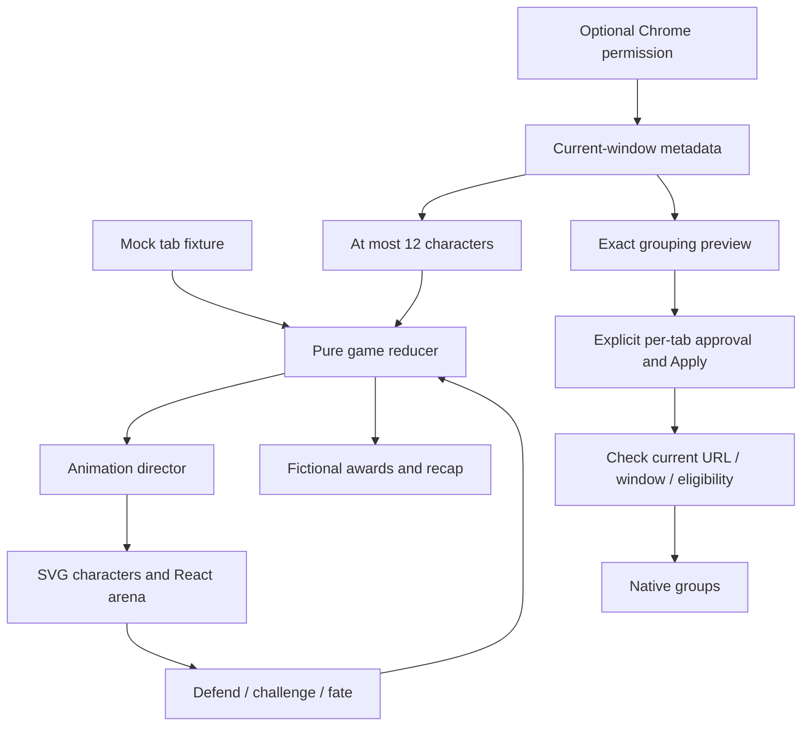

# Architecture

## Logical state

`GameState` owns phase, beat index, character facts and relationships, selected character, interventions, decisions, and history. No Chrome globals are imported into `game-core`. The deterministic story deck uses the same snapshot and seed on every run. Exact-URL duplicate detection preserves the query string; fragments are ignored. Classification matches domain boundaries, never arbitrary substrings.

`NEXT` advances one story beat and applies its effects. Further `NEXT` events outside the playing phase do nothing. The finale requires a decision for every character and enforces at most six kept characters. Defend/Challenge affect clamped trust and confidence; defending and later retiring a tab enables the Betrayer ending. Reset reconstructs the original cast.

## Animation ownership

One `AnimationDirector` owns the active story clock or a short player interruption. Pause freezes elapsed time and CSS animations. Skip cancels the active clock and resolves one completion. Unmount cancels callbacks. An interruption temporarily replaces the caption and then restarts the interrupted story beat without replaying its reducer effects.

SVG rigs keep body, shadow, limbs, pupils, brows, and mouth separate. CSS supplies movement and facial changes. Motion provides pointer dragging, with page-to-viewport coordinate conversion for drop detection on scrolled pages. Reduced motion disables CSS loops, entrances, projectiles, and dragging; identical outcomes remain available through buttons.

## Extension boundary

The MV3 action opens an extension document. All authoritative state stays in that visible document, so no persistent service worker is needed. Permissions are requested only from the Connect button. Both titles and URLs remain on-device, and no page bodies, history, content scripts, or host permissions are used.

A complete preflight runs before the first approved mutation. Every group is checked again immediately before its call. URLs, window, pinned/private status, and pending navigation are checked against the original snapshot. Chrome operations are inherently non-atomic: a tab could change between the final check and Chrome's operation, or later operations can fail. Successful group calls are recorded before naming, ensuring a naming failure does not hide an already-created group. On failure the loop stops and tells the user which groups succeeded. Reload to refresh before retrying.

The extension is not allowed in incognito windows. Internal URLs are ineligible. Pinned tabs are excluded entirely from the real cast in this MVP. Group preview decisions are deliberately independent of fictional votes and require a separate explicit approval.

## Phase-two state and recovery

`actionTarget` owns the current speaker independently of `selected`, so selecting another character cannot redirect an in-progress intervention. An Undo stack stores the previous fate and emotion for each verdict; replaying the same verdict is a no-op. Undo is only available before results.

`featuredTabs` preserves one duplicate pair, samples each present category, then fills remaining seats in stable order. Exact domains take precedence over conservative local title hints; no page bodies or history are read. Full titles remain available while CSS bounds labels.

Versioned sessionStorage checkpoints are validated against the current cast before hydration. Only logical game state is restored; transient speech, grouping approvals, and browser operations are never resumed. Story scenes restart paused at their current beat. The extension first checks existing permissions and reconstructs snapshot facts from a fresh same-window scan. Any saved tab that moved, closed, navigated, or became protected invalidates that snapshot. Browser-managed tab restoration can retain sessionStorage, so the extension offers an explicit Forget session action.

The SVG recap is generated locally from the fictional ending and aggregate fate counts; it deliberately excludes tab titles, URLs, IDs, and categories. The separate text recap keeps the detailed character list.
